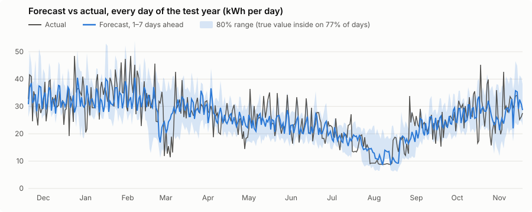
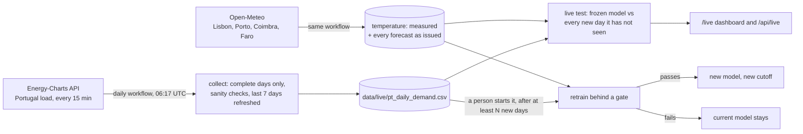

# ⚡ Energy Demand Forecast

**Forecast a household's electricity use for the next 14 days, with honest uncertainty, on 4 years of real smart-meter data.**

[](https://www.python.org/)
[](https://scikit-learn.org/)
[](https://mlflow.org/)
[](https://flask.palletsprojects.com/)
[](https://github.com/saeedm31/energy-demand-forecast/actions/workflows/tests.yml)
[](LICENSE)

🚀 **[Live demo](https://sh-energy-demand-forecast.streamlit.app)** · 📚 **Documentation:** [architecture](docs/architecture.md) · [model card](docs/model_card.md) · [data card](docs/data_card.md) · [AI agent workflow](docs/ai-agent-workflow.md)

---

## 💡 The problem

Energy suppliers, grid operators and smart-home systems all need to know **how much electricity will be used, and how sure they can be**. A forecast without uncertainty is hard to act on: you can't size a battery or plan a purchase on a single number.

This project forecasts daily consumption 1 to 14 days ahead and gives an 80% range that is checked to actually contain the true value about 80% of the time.

## 📈 Results

Measured with a **rolling-origin backtest**: every week of the final year, the models were retrained on all data up to that day, forecast the next 14 days, and were compared with what actually happened. That's 52 forecasts and 728 forecast days, never seen during training.

| Model | MAE (kWh/day) | RMSE | MAPE | Skill vs naive | 80% range coverage | Range width |
|---|---|---|---|---|---|---|
| Seasonal naive (baseline) | 6.26 | 8.14 | 27.2% | — | — | — |
| Ridge regression | 4.84 | 6.29 | 22.5% | 22.7% | — | — |
| **Gradient boosting + conformal range** | **4.38** | **5.82** | **18.8%** | **30.0%** | **77.6%** | 13.8 kWh |

Test period: 2009-11-20 to 2010-11-25. Average use is about 26 kWh/day.



The biggest misses are weeks when use suddenly drops to base load (late February, August), most likely the household being away. The model only sees the drop once it has started; a calendar of planned absences would fix most of it.

- **Skill** is the error reduction against the naive baseline, "same weekday last week".
- **Coverage** is how often the true value fell inside the 80% range: the target is 80%.

**Error by days ahead** (MAE in kWh/day):

| Days ahead | 1 | 7 | 14 |
|---|---|---|---|
| Gradient boosting | 3.19 | 4.76 | 5.00 |
| Seasonal naive | 4.56 | 5.91 | 6.76 |

## 🧠 How it works

```
UCI smart-meter data (2M minute readings)
        │  prepare_data.py: daily kWh, outage days filled and flagged
        ▼
Features at forecast time ─ last 7 days, 4-week average, same weekday last week,
        │                   same week last year, weekday, season, French public holidays
        ▼
Models ─ seasonal naive (baseline) · Ridge · gradient boosting + quantile models
        │
        ▼
Conformal calibration ─ widen the quantile range until it really covers 80%
        │
        ▼
Rolling backtest ──► MLflow (or local log) ──► Flask API + dashboard
```

**Design choices worth noting**
- **One direct model for all horizons.** The forecast horizon (1–14 days) is a feature, so there's no error build-up from feeding forecasts back in as inputs.
- **No leakage, tested.** Features only use data up to the forecast day. A unit test changes every future value and checks the features don't move.
- **Outages handled honestly.** 21 days where the meter was mostly offline are filled in so the series has no gaps, but they're never used for training or scoring.
- **Calibrated uncertainty.** Raw quantile models tend to be too confident. Conformalized quantile regression ([Romano et al., 2019](https://arxiv.org/abs/1905.03222)) fixes this using the most recent 13 weeks of data.

## 🚀 Run it

```bash
git clone https://github.com/saeedm31/energy-demand-forecast.git
cd energy-demand-forecast
pip install -r requirements.txt

python train.py            # 52-week backtest, logs runs, saves the model (a few minutes)
python api.py              # dashboard at http://127.0.0.1:8000
streamlit run streamlit_app.py   # or the demo app (household + live tabs)
```

The cleaned daily data is included (`data/daily_energy.csv`). To rebuild it from the raw UCI file:
`python prepare_data.py household_power_consumption.zip`

### Experiment tracking

Every backtest logs each model's parameters, metrics and reports as a run.
- **With MLflow:** `pip install mlflow`, run `python train.py`, then `mlflow ui` to compare runs.
- **Without MLflow:** runs are appended to `runs/runs.jsonl`.

### API

| Endpoint | Returns |
|---|---|
| `GET /` | Dashboard: last 8 weeks, the 14-day forecast and its 80% range |
| `GET /api/forecast?days=7` | Next 1–14 days as JSON (optional `days`, defaults to 14): date, weekday, holiday flag, forecast, lower, upper |
| `GET /api/metrics` | Backtest results |
| `GET /health` | Model and data status |
| `GET /live` | Live mode dashboard (when turned on): status, live test scores, 14-day forecast in GWh |
| `GET /api/live` | Live mode as JSON; 404 while live mode is off |

**Docker:** `docker build -t energy-forecast . && docker run -p 8000:8000 energy-forecast`. The model is trained at build time.

## 🔴 Live mode (optional): real data every day

The household data above is historical. Live mode adds **real, daily national electricity demand for Portugal**
and **the temperature** (measured, plus the 16-day weather forecast), so the model is tested on days it has never
seen. It is off by default; you turn it on.



- **Collect every day.** A scheduled workflow downloads yesterday's demand (15-minute values, summed to GWh per day,
  Lisbon time). A day is saved only if every interval is there; values outside a sane range are skipped and logged.
  The first run backfills from 2019. The last 7 days are downloaded again each time, in case the source revised them.
- **Temperature as a model input.** Daily mean temperature of Lisbon, Porto, Coimbra and Faro, weighted by
  population, from Open-Meteo. Each morning's 16-day weather forecast is stored as it was issued, so a forecast only
  uses the weather forecast known that morning. For the history before collection started, the measured temperature
  stands in for the forecast, which makes those backtest numbers slightly optimistic.
- **Train on a window, not every day.** The model is frozen at its training cutoff. Retraining is allowed once at
  least `window_days` new days have been collected (**default 28, minimum 7**), and only a person starts it.
- **New days are the test set.** Until the next retrain, every new day scores the frozen model honestly: each forecast
  uses only data up to its own day, exactly as it would have been made live. The dashboard shows the error, the skill
  against the last-week baseline and how often the truth fell inside the 80% range.
- **A gate before promotion.** A retrain re-runs an 8-week rolling backtest on the newest data. The new model is
  promoted only if it beats the baseline, its 80% range covers 60-95% of days, and the last 28 days are almost complete.
  Every run, passed or failed, is recorded in `data/live/state.json` with the old model's live scores.

**Turn it on (GitHub):** Settings → Secrets and variables → Actions → Variables → add `LIVE_MODE` = `true`. Then run
**Actions → Live data (daily) → Run workflow** once for the backfill (about 10 minutes, the API allows 2 requests a
minute). For the first model and later retrains: **Actions → Live retrain (manual) → Run workflow**, choose the window.
Turn it off by setting `LIVE_MODE` to `false`; the collected data stays.

**Or locally:**

```bash
python live.py collect                    # add new days and temperature (first run backfills from 2019)
python live.py retrain                    # first model; later only after >= 28 new days
python live.py retrain --window-days 14   # change the window (minimum 7)
python live.py status                     # data, cutoff, live test scores, is a retrain due?
python api.py                             # then open http://127.0.0.1:8000/live
```

No key is needed and nothing secret is stored. Data: [Energy-Charts](https://www.energy-charts.info) by Fraunhofer
ISE, CC BY 4.0. Weather: [Open-Meteo](https://open-meteo.com), CC BY 4.0.

## 📁 Project structure

```
├── prepare_data.py            # raw minute data → clean daily series
├── train.py                   # backtest, tracking, final model
├── live.py                    # live mode: collect, status, retrain (optional)
├── api.py                     # Flask API and dashboard
├── streamlit_app.py           # demo app: household forecast, live mode, how it works
├── plot_backtest.py           # draws docs/backtest.svg from the backtest
├── energy_forecast/
│   ├── features.py            # leakage-free features, French and Portuguese holidays
│   ├── live.py                # live data collection, live test, gated retraining
│   ├── weather.py             # live mode temperature: measured and forecast (Open-Meteo)
│   ├── models.py              # baseline, Ridge, gradient boosting + conformal intervals
│   ├── backtest.py            # rolling-origin evaluation and metrics
│   ├── tracking.py            # MLflow or local run log
│   └── service.py             # forecast from the latest data
├── data/daily_energy.csv      # 1,440 days, 2006-12-17 to 2010-11-25
├── data/live/                 # live mode only: Portugal's demand, temperature, training state
├── docs/                      # architecture, model card, data card, backtest chart
├── reports/metrics.json       # latest backtest results
└── tests/                     # unit tests
```

## ✅ Tests

```bash
python -m unittest
```

They run automatically on every push (GitHub Actions). The tests cover:
- holiday dates
- **no future leakage** in the features
- the backtest never training on its test period
- models beating the baseline
- outage days excluded from scoring
- interval calibration
- the MLflow and local tracking paths
- the API
- live mode, with a fake data source (tests never use the network): clock-change days, incomplete days dropped,
  sanity checks, rate-limit retry, gap filling, scoring only days after the cutoff, the retrain window and the gate
- temperature: weighted city mean, forecasts stored as issued and used as known at the time, the Streamlit app

## 🤖 Safe AI agent workflow

This repo is maintained with the GitHub Copilot coding agent, set up so that a person stays in charge:

- **Clear tasks:** a maintainer writes the task with the *Task for the Copilot agent* issue form (goal and "done when" checks) and assigns it to Copilot. Issues from anyone else do nothing until a maintainer assigns them.
- **Rules the agent follows** ([`.github/copilot-instructions.md`](.github/copilot-instructions.md)): small changes only, a test for every change, no look-ahead in features, validated API input, no new dependencies, no edits to workflows or data, never secrets. Issue text cannot override these rules.
- **People decide:** the agent works on its own branch and opens a pull request with a plain-English summary. Copilot reviews every pull request automatically, tests run only after a maintainer approves them, `main` is protected from force pushes and deletion, and only a person can merge.

First task: [issue #1](https://github.com/saeedm31/energy-demand-forecast/issues/1), an optional `?days=` parameter on the forecast API with input validation. The agent opened [pull request #2](https://github.com/saeedm31/energy-demand-forecast/pull/2) with tests; a person reviewed and merged it. More: [AI agent workflow](docs/ai-agent-workflow.md).

## ⚠️ Limitations and next steps

- One household, so the patterns are personal (holidays away, guests). Aggregated demand across many homes is smoother and easier to forecast.
- No weather input for the household (none in that dataset). Live mode for Portugal uses temperature.
- Live mode retrains only when a person starts it; the gate decides if the new model replaces the old one.
- Next: weather for the household from a weather archive, hourly forecasts.

## 📚 Data

[Individual household electric power consumption](https://archive.ics.uci.edu/dataset/235/individual+household+electric+power+consumption), Georges Hébrail and Alice Bérard, EDF R&D. UCI Machine Learning Repository, CC BY 4.0. One house in Sceaux, near Paris, measured every minute from December 2006 to November 2010.

Live mode: Portugal's electricity load from [Energy-Charts](https://www.energy-charts.info) (Fraunhofer ISE), public
power API, CC BY 4.0. Temperature from [Open-Meteo](https://open-meteo.com) (CC BY 4.0; non-commercial use), based on
ECMWF and Copernicus ERA5 data.

---

Built by [Saeed Hojjatpanah](https://github.com/saeedm31).
