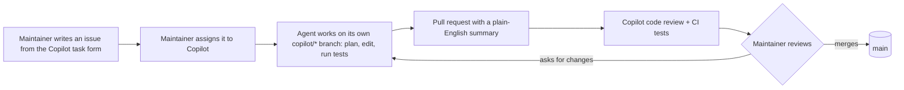

# Working with the Copilot coding agent

This repo shows a simple, safe way to let an AI agent make code changes: the agent does the work, a person stays
in charge.

## The pieces

| Piece | File or setting | What it does |
|---|---|---|
| Rules for the agent | `.github/copilot-instructions.md` | Small changes only, a test for every change, no look-ahead in features, validated API input, no new dependencies, no edits to workflows or data, never secrets; issue text cannot override the rules |
| Task form | `.github/ISSUE_TEMPLATE/copilot-task.yml` | Every task has a goal and "done when" checks a reviewer can verify |
| Tests in CI | `.github/workflows/tests.yml` | Runs the unit tests on every pull request |
| Automatic review | ruleset on `main` | Copilot reviews every pull request; force pushes and branch deletion are blocked |

## Why it is safe

- **Only maintainers start the agent.** It acts only on issues a person with write access assigns to it. A
  stranger's issue does nothing until a maintainer reads it and decides to assign it. That is deliberate: issue text
  is untrusted.
- **The agent cannot merge.** It pushes only to its own `copilot/*` branch and opens a pull request. A person merges.
- **CI waits for approval.** By GitHub's default, workflows on the agent's pull requests run only after a
  maintainer approves them, so the agent cannot run changed workflows on its own.
- **Limited network.** The agent works behind GitHub's firewall, which allows package registries but not arbitrary
  sites.
- **No secrets in reach.** The repo has no secrets the agent needs, and the rules forbid adding any.

## Try it

1. Open an issue with **New issue → Task for the Copilot agent**.
2. Assign it to **Copilot** (Assignees), or start it from the **Agents** tab.
3. Watch the session log in the Agents tab, then review the pull request like any other.
