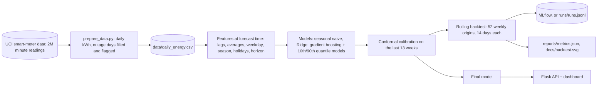

# Architecture

## The parts

| Part | Code | What it does |
|---|---|---|
| Data preparation | `prepare_data.py` | minute readings to daily kWh; 21 outage days filled so the series has no gaps, flagged and never used for training or scoring |
| Features | `energy_forecast/features.py` | only data up to the forecast day: last 3 days, 7- and 28-day averages and spread, same weekday last week, same week last year, weekday, season, French public holidays, and the horizon (1-14) |
| Models | `energy_forecast/models.py` | seasonal naive baseline, Ridge, and gradient boosting with two quantile models and a conformal margin |
| Backtest | `energy_forecast/backtest.py` | every week of the final year: retrain on all data up to that day, forecast 14 days, score |
| Tracking | `energy_forecast/tracking.py` | MLflow when installed, otherwise a local JSON-lines log |
| Service | `energy_forecast/service.py` | the next 14 days from the latest data |
| API | `api.py` | dashboard, `/api/forecast`, `/api/metrics`, `/health` |

## One direct model for all horizons

The horizon is a feature, so one model forecasts days 1 to 14 directly. Forecasts are never fed back in as inputs,
so errors do not build up.

## Where it runs

| Piece | Local | Docker | GitHub Actions |
|---|---|---|---|
| Backtest and final model | `python train.py` (a few minutes) | trained at image build time | - |
| API and dashboard | `python api.py` on port 8000 | `docker run -p 8000:8000 energy-forecast` | API tests |
| Experiment tracking | `mlflow ui`, or `runs/runs.jsonl` | - | the MLflow and local paths are tested |
| Tests | `python -m unittest` | - | every push |

## Live mode (optional)

Off by default. When the repository variable `LIVE_MODE` is `true`, a daily workflow adds yesterday's national
demand for Portugal from the Energy-Charts API (series `load`, 15-minute MW values summed to GWh per Lisbon day).
Only complete days pass, values outside 40-300 GWh are rejected, and the last 7 days are refreshed each run.

The model is frozen at a training cutoff stored in `data/live/state.json`. Days after the cutoff are the live test
set: the frozen model forecasts each of them from data up to its own origin day, and `/live` shows the error,
skill against the baseline and interval coverage. A person starts a retrain (manual workflow or `python live.py
retrain`) once at least `window_days` new days exist (default 28, minimum 7). An 8-week rolling backtest on the
newest data gates promotion: beat the baseline, 80% range covering 60-95%, recent data complete. Each run is logged
in the state file, with the previous model's live scores. Training is deterministic, so the state file (not a
binary model) is what is committed; the API rebuilds and caches the model for that cutoff.

| Piece | Where |
|---|---|
| Collection, checks, live test, gate | `energy_forecast/live.py`, `live.py` |
| Daily collection | `.github/workflows/live-data.yml` (runs only if `LIVE_MODE` is `true`) |
| Manual retrain | `.github/workflows/live-retrain.yml` (window and force as inputs) |
| Dashboard and JSON | `/live`, `/api/live` in `api.py` |

## Path to production

Live mode already shows the loop on real data: daily collection, a frozen model tested on new days, and
gated retraining started by a person. For a household product the same loop would read the meter instead.
Next: a weather forecast as an input (temperature drives heating demand), and a calendar of planned absences for
the biggest misses.

More: [model card](model_card.md) · [data card](data_card.md)
