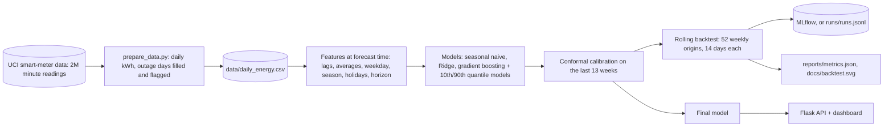

# Architecture

## The parts

| Part | Code | What it does |
|---|---|---|
| Data preparation | `prepare_data.py` | minute readings to daily kWh; 21 outage days filled so the series has no gaps, flagged and never used for training or scoring |
| Features | `energy_forecast/features.py` | only data up to the forecast day: last 3 days, 7- and 28-day averages and spread, same weekday last week, same week last year, weekday, season, French public holidays, and the horizon (1-14) |
| Models | `energy_forecast/models.py` | seasonal naive baseline, Ridge, and gradient boosting with two quantile models and a conformal margin |
| Backtest | `energy_forecast/backtest.py` | every week of the final year: retrain on all data up to that day, forecast 14 days, score |
| Tracking | `energy_forecast/tracking.py` | MLflow when installed, otherwise a local JSON-lines log |
| Service | `energy_forecast/service.py` | the next 14 days from the latest data |
| API | `api.py` | dashboard, `/api/forecast`, `/api/metrics`, `/health` |

## One direct model for all horizons

The horizon is a feature, so one model forecasts days 1 to 14 directly. Forecasts are never fed back in as inputs,
so errors do not build up.

## Where it runs

| Piece | Local | Docker | GitHub Actions |
|---|---|---|---|
| Backtest and final model | `python train.py` (a few minutes) | trained at image build time | - |
| API and dashboard | `python api.py` on port 8000 | `docker run -p 8000:8000 energy-forecast` | API tests |
| Experiment tracking | `mlflow ui`, or `runs/runs.jsonl` | - | the MLflow and local paths are tested |
| Tests | `python -m unittest` | - | every push |

## Path to production

A scheduled job adds yesterday's meter data, retrains weekly with the same backtest as a gate, and publishes the
model; the API serves the latest forecast. Add a weather forecast as an input (temperature drives heating demand),
and a calendar of planned absences for the biggest misses.

More: [model card](model_card.md) · [data card](data_card.md)
